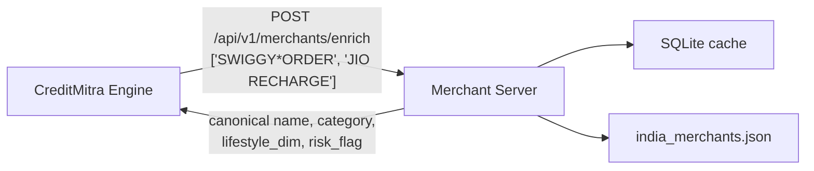

# CreditMitra Merchant Server

> Standalone merchant-enrichment microservice — resolves raw bank-statement
> payee strings into canonical merchants with a category, lifestyle dimension,
> and risk flag.

Extracted from the [CreditMitra Engine](https://github.com/CreditMitra-TIH-IITB/CreditMitra-engine)
so that merchant knowledge can be updated, scaled, and audited independently of
the statement-parsing pipeline (Issue #9).

---

## Why it is separate

The engine sees real bank statements. This service only ever sees a **flat list
of merchant name strings** — no amounts, no dates, no balances, no account
identifiers. Keeping it in its own process makes that privacy boundary explicit
and testable rather than a convention someone has to remember.



If this service is unreachable, the engine falls back to its own local resolver,
so enrichment degrades rather than fails.

---

## Resolution order

| Step | Source | Notes |
|---|---|---|
| 1 | SQLite cache | Keyed on the normalized name; also caches misses |
| 2 | `data/india_merchants.json` | Exact alias match, then prefix match (aliases ≥ 4 chars) |
| 3 | Fallback | `category: other`, `lifestyle_dim: neutral` |

Normalization strips punctuation and common noise tokens (`PVT`, `LTD`,
`PAYMENTS`, `RECHARGE`, `INDIA`, …) before matching, which is what lets
`SWIGGY*ORDER PVT LTD` and `Swiggy` collapse to the same entry.

---

## API

### `GET /health`

```json
{ "status": "ok", "service": "merchant-server" }
```

### `POST /api/v1/merchants/enrich`

Requires the `X-API-Key` header. Results come back in the **same order** as the
request, one per input string.

```bash
curl -X POST http://localhost:8001/api/v1/merchants/enrich \
  -H "X-API-Key: $MERCHANT_API_KEY" \
  -H "Content-Type: application/json" \
  -d '{"merchants": ["SWIGGY*ORDER", "JIO RECHARGE"]}'
```

```json
{
  "results": [
    {
      "canonical_name": "Swiggy",
      "category": "food_delivery",
      "is_essential": false,
      "risk_flag": null,
      "lifestyle_dim": "aspirational",
      "recurring_type": "adhoc"
    }
  ]
}
```

| Status | Meaning |
|---|---|
| `200` | Enriched |
| `401` | Missing or wrong `X-API-Key` |
| `503` | `MERCHANT_API_KEY` is not configured on the server |

---

## Configuration

| Variable | Required | Description |
|---|---|---|
| `MERCHANT_API_KEY` | Yes | Shared secret the engine sends as `X-API-Key` |

The endpoint **fails closed**: with no key configured it returns `503` rather
than serving unauthenticated requests. Set the same value as the engine's
`MERCHANT_API_KEY`, and point the engine at this service with
`MERCHANT_ENRICHMENT_URL=http://localhost:8001`.

---

## Running

```bash
pip install -r requirements.txt
MERCHANT_API_KEY=dev-key uvicorn app.main:app --port 8001
```

Docker:

```bash
docker build -t creditmitra-merchant-server .
docker run -p 8001:8001 -e MERCHANT_API_KEY=dev-key creditmitra-merchant-server
```

Tests:

```bash
pip install -r requirements-dev.txt && pytest -q
```

---

## Data handling

`data/enrichment_cache.db` is written at runtime and holds payee strings taken
from real statements, so it is excluded by both `.gitignore` and
`.dockerignore`. Do not commit it or copy it into an image.
