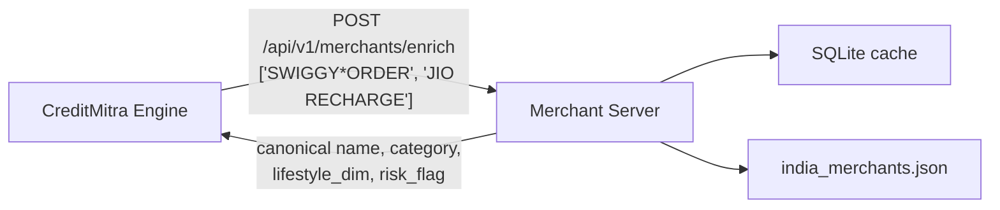

# CreditMitra Merchant Server

> Standalone merchant-enrichment microservice — resolves raw bank-statement
> payee strings into canonical merchants with a category, lifestyle dimension,
> and risk flag.

Extracted from the [CreditMitra Engine](https://github.com/CreditMitra-TIH-IITB/CreditMitra-engine)
so that merchant knowledge can be updated, scaled, and audited independently of
the statement-parsing pipeline (Issue #9).

---

## Why it is separate

The engine sees real bank statements. This service only ever sees a **flat list
of merchant name strings** — no amounts, no dates, no balances, no account
identifiers. Keeping it in its own process makes that privacy boundary explicit
and testable rather than a convention someone has to remember.



If this service is unreachable, the engine falls back to its own local resolver,
so enrichment degrades rather than fails.

---

## Resolution order

| Step | Source | Notes |
|---|---|---|
| 1 | SQLite cache | Keyed on the normalized name, stamped with the dictionary version |
| 2 | `data/india_merchants.json` | Exact alias match, then longest-prefix match (aliases ≥ 4 chars) |
| 3 | Fallback | `category: other`, `source: unknown`, and a row in the curation queue |

Normalization strips punctuation and common noise tokens (`PVT`, `LTD`,
`PAYMENTS`, `RECHARGE`, `INDIA`, …) before matching, which is what lets
`SWIGGY*ORDER PVT LTD` and `Swiggy` collapse to the same entry. Prefix matching
handles UPI truncation — real narrations cut names to about ten characters, so
`SWIGGY LI` and `FLIPKAR T` have to resolve.

### The cache cannot go stale

Every cached answer carries the **content hash of the dictionary that produced
it**, and misses additionally expire after seven days. Both rules exist because
the cache is consulted *before* the dictionary: without them, a name that failed
to resolve once was frozen as `other` permanently, so adding a merchant changed
nothing for exactly the merchants users had already hit. Restarting did not help
either — only deleting the database did.

Editing the dictionary changes its hash, which retires every answer derived from
the old one. No cache flush, and `POST /api/v1/merchants/reload` picks up an edit
without a restart.

## The curation queue

A miss used to be invisible: the caller got `other`, nothing was recorded, and
there was no way to learn which merchants were worth adding. Unresolved names are
now logged with a frequency count.

```bash
curl -H "X-API-Key: $MERCHANT_API_KEY" \
  "http://localhost:8001/api/v1/merchants/unresolved?min_count=3"
```

```json
{
  "dictionary_version": "da5fffc406c3",
  "total": 2,
  "items": [
    { "normalized_name": "sri balaji stores", "sample_raw_name": "SRI BALAJI STORES",
      "hit_count": 47, "first_seen": 1756200000.0, "last_seen": 1756900000.0 }
  ]
}
```

Counts are **per request, not per row** — a batch is deduplicated before
resolution, so six IRCTC lines in one statement are one lookup and one miss.
Counting rows would rank a merchant one person pays daily above one that many
different people cannot resolve, which is the wrong priority for a work queue.

Once a name resolves it is dropped from the queue, so the list stays a to-do
rather than a history. The intended loop:

```
unresolved name ──► queue (name + frequency) ──► add to dictionary
                                                       │
                                             version changes, stale
                                             answers retire themselves
```

> The queue concentrates exactly the names that do not look like merchants —
> which includes any person misclassified as one upstream. Treat it as reviewed
> data, not a public endpoint, and keep it behind the API key as it is today.

## The curation loop

The queue curates itself. A scheduled job works through it, and what clears the
bar is written to the dictionary automatically.

```bash
curl -X POST -H "X-API-Key: $MERCHANT_API_KEY"   "http://localhost:8001/api/v1/merchants/propose?limit=25"
```

For each unresolved name asked for at least `MERCHANT_MIN_HIT_COUNT` times:

```
evidence   = LangSearch(name)
grounded   = model(name, evidence)      ── path 1
parametric = model(name, no evidence)   ── path 2
record candidate; promote if it clears the bar for its severity tier
```

**Two paths, so agreement is usable as confidence.** A model recalling a
merchant from its weights and a model reading live search results are wrong in
different ways; when they land on the same category that is meaningfully
stronger than either alone, and it costs one extra call on a workload measured
in hundreds of merchants.

**The model picks one thing.** It chooses `category`; `is_essential`,
`lifestyle_dim` and `risk_flag` are looked up from the taxonomy. A proposal of
`gambling` with `lifestyle_dim: essential` is not something to defend against,
because it cannot be expressed.

**`MERCHANT_MIN_HIT_COUNT` is a privacy control as much as a cost one.** A
person's name appears in one customer's statement; a real merchant appears
across many. Requiring repeats keeps most misclassified individuals out of the
proposal path before anything leaves this server.

### Promotion is automatic

Candidates above threshold reach the dictionary with no human in the loop. Two
things make that survivable:

| Tier | Categories | Bar |
|---|---|---|
| Ordinary | everything else | confidence ≥ `MERCHANT_PROMOTE_THRESHOLD` (0.75) |
| High severity | `gambling`, `bnpl_lending`, `crypto`, `loan_emi` | confidence ≥ 0.90 **and** both paths agree |

The second tier exists because those labels are the ones that damage a borrower
when they are wrong — a false `gambling` tag drives L6 to zero and lands the
person in the Gambler archetype — and the ones a model most readily over-applies,
since any payments app can look like a lender from a name alone. It is a higher
threshold, not a review gate; `MERCHANT_REQUIRE_AGREEMENT=0` flattens it.

Every promotion carries its provenance into the dictionary entry:

```json
"provenance": {
  "source": "auto", "model": "gemini:gemini-2.0-flash", "confidence": 0.93,
  "summary": "...", "evidence": "...", "promoted_at": 1756900000.0
}
```

So "why is this tagged gambling, and on what evidence" is answerable months
later without re-running anything.

```bash
# what got promoted, what was held, and why
curl -H "X-API-Key: $KEY" "localhost:8001/api/v1/merchants/candidates?status=held"

# undo a bad automatic promotion
curl -X POST -H "X-API-Key: $KEY" "localhost:8001/api/v1/merchants/reverse/nykaa%20fashion"
```

Reversal only removes entries the proposer wrote — a hand-curated merchant is
never touched by an audit. The dictionary hash changes either way, so cached
answers derived from a reversed entry retire themselves.

### Choosing a model

`MERCHANT_LLM_PROVIDER` selects the backend and the interface is deliberately
thin, because WP3 asks for a comparison across models on cost, coverage and
speed rather than a vendor decision. With no key configured the provider
abstains on everything — a server with no model should add nothing to the
dictionary, not guess from names.

The number worth optimising is **precision on non-abstentions, not coverage**.
An abstention leaves a merchant as `other` and costs a little coverage. A
confident mislabel corrupts every index that reads the category and never
surfaces on its own. Any model that cannot reliably say "I don't know" is
disqualified regardless of how good its accuracy looks.

> The Gemini and LangSearch calls have **not been exercised against the live
> APIs** — they were written without outbound network access. The pipeline,
> the gate and the audit trail are covered by tests using fake providers;
> expect to fix small things in the request/response shapes on first contact.

---

## API

### `GET /health`

```json
{ "status": "ok", "service": "merchant-server" }
```

### `POST /api/v1/merchants/enrich`

Requires the `X-API-Key` header. Results come back in the **same order** as the
request, one per input string.

```bash
curl -X POST http://localhost:8001/api/v1/merchants/enrich \
  -H "X-API-Key: $MERCHANT_API_KEY" \
  -H "Content-Type: application/json" \
  -d '{"merchants": ["SWIGGY*ORDER", "JIO RECHARGE"]}'
```

```json
{
  "results": [
    {
      "canonical_name": "Swiggy",
      "category": "food_delivery",
      "is_essential": false,
      "risk_flag": null,
      "lifestyle_dim": "aspirational",
      "recurring_type": "adhoc"
    }
  ]
}
```

| Status | Meaning |
|---|---|
| `200` | Enriched |
| `401` | Missing or wrong `X-API-Key` |
| `422` | More than 1000 names in one batch |
| `503` | `MERCHANT_API_KEY` is not configured on the server |

Each result carries a `source` (`dictionary` or `unknown`) and the response
carries `dictionary_version` and `resolved_count`. Without provenance a caller
cannot tell a real hit from the safe fallback — both arrive as a well-formed
`MerchantEnrichment` — so resolution quality is unmeasurable and the engine's
`merchant_resolution_rate` counts failures as successes.

---

## Configuration

| Variable | Required | Description |
|---|---|---|
| `MERCHANT_API_KEY` | Yes | Shared secret the engine sends as `X-API-Key` |

The endpoint **fails closed**: with no key configured it returns `503` rather
than serving unauthenticated requests. Set the same value as the engine's
`MERCHANT_API_KEY`, and point the engine at this service with
`MERCHANT_ENRICHMENT_URL=http://localhost:8001`.

---

## Running

```bash
pip install -r requirements.txt
MERCHANT_API_KEY=dev-key uvicorn app.main:app --port 8001
```

Docker:

```bash
docker build -t creditmitra-merchant-server .
docker run -p 8001:8001 -e MERCHANT_API_KEY=dev-key creditmitra-merchant-server
```

Tests:

```bash
pip install -r requirements-dev.txt && pytest -q
```

---

## Data handling

`data/enrichment_cache.db` is written at runtime and holds payee strings taken
from real statements, so it is excluded by both `.gitignore` and
`.dockerignore`. Do not commit it or copy it into an image.
